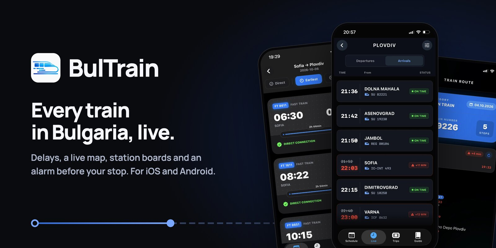
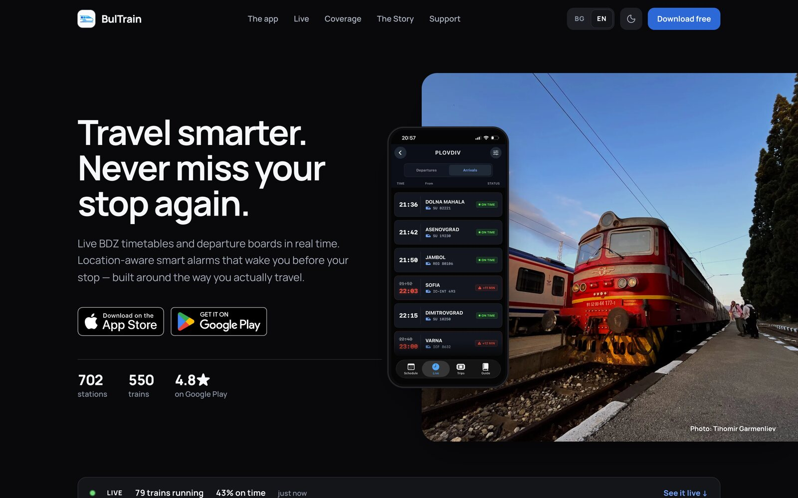
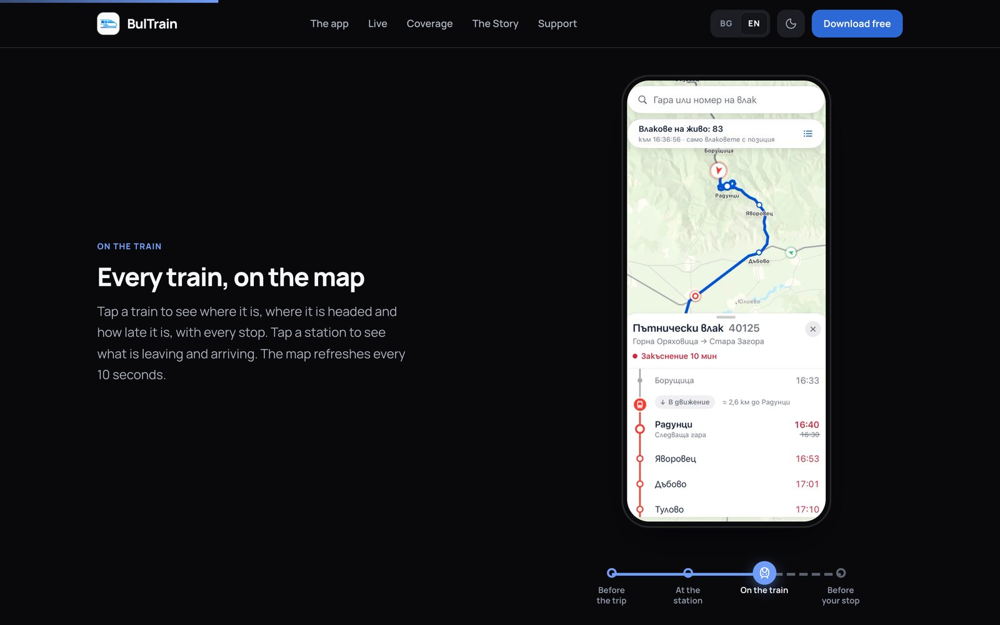
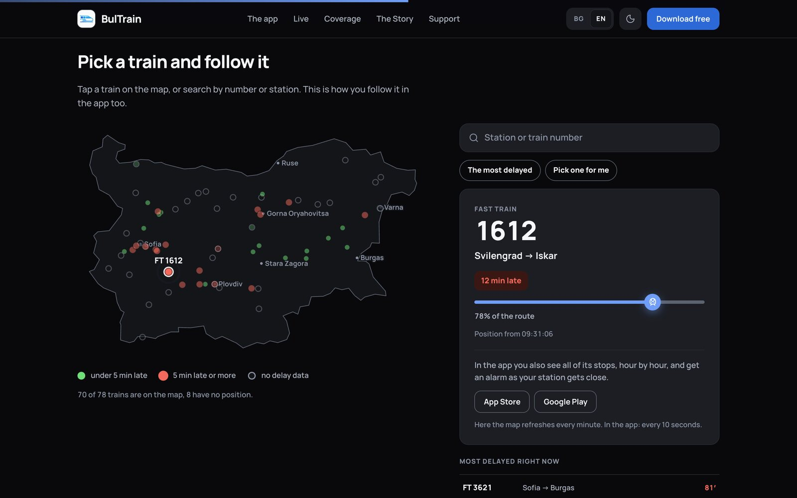

<p align="center">
  <a href="https://bultrain.eu/en">
    
  </a>
</p>

<p align="center">
  The website of <b>BulTrain</b>, an app that shows train delays, a live map and station boards for Bulgaria,<br>
  and wakes you before your stop.
</p>

<p align="center">
  <a href="https://bultrain.eu/en"><b>bultrain.eu</b></a>
  &nbsp;·&nbsp;
  <a href="https://apps.apple.com/bg/app/bultrain-train-schedules-bg/id6759790703">App Store</a>
  &nbsp;·&nbsp;
  <a href="https://play.google.com/store/apps/details?id=com.bultrain.vlak_app_test">Google Play</a>
</p>

<p align="center">
  <a href="https://bultrain.eu"></a>
  
  
  
  
</p>

> 🇧🇬 **BulTrain** показва закъсненията и местоположението на влаковете в България в реално време, има табла на гарите и аларма, която те известява, преди да пристигнеш. Това е кодът на сайта [bultrain.eu](https://bultrain.eu).

## The app

| | |
|---|---|
| **Live delays** | From the official public feed. If there is no live data, the app says so. |
| **Live map** | The trains of Bulgaria on a map. Tap a train or a station. |
| **Station boards** | Departures and arrivals for 702 stations. |
| **Smart alarm** | Wakes you near your station. Works offline; your location stays on the phone. |
| **Journey tracking** | Live Activity on iPhone, an ongoing notification on Android, a card on Apple Watch. |

## The website

<p align="center">
  <picture>
    <source media="(prefers-color-scheme: light)" srcset="docs/media/hero-light.jpg">
    
  </picture>
</p>

<table>
  <tr>
    <td width="50%"></td>
    <td width="50%"></td>
  </tr>
  <tr>
    <td align="center"><sub><b>One journey</b>: the tour follows a trip, from search to your stop.</sub></td>
    <td align="center"><sub><b>Pick a train</b>: search the trains running right now and follow one.</sub></td>
  </tr>
</table>

- **Real data, honestly shown.** Station boards and the train picker read the BulTrain API. Missing values are said to be missing, never estimated.
- **Two languages, two themes.** Bulgarian at `/`, English at `/en`; light and dark follow the device.
- **Fast and findable.** Every page is prerendered at build time, with its own metadata, `hreflang` and structured data.
- **Private by default.** No cookies, no analytics, no trackers. Fonts are self-hosted.
- **Hardened.** A strict Content Security Policy and security headers are generated on every build.

## Built with

**React 19** · **Vite 8** · **React Router 7** · hand-written CSS with design tokens · a small custom prerender step · deployed on **Cloudflare**

## Run it locally

Requires Node 20.19 or newer.

```bash
npm install
npm run dev
```

The site opens on `http://localhost:5173`. Keep that port: the live-data API only accepts known origins.

| Command | What it does |
|---|---|
| `npm run dev` | Development server |
| `npm run build` | Production build: bundle, prerender all pages, sitemap, security headers |
| `npm run lint` | ESLint |

## Project layout

```text
src/
  site/        sections of the pages, each with its own stylesheet
  pages/       privacy, terms, contact
  data/        live data, app screenshots, press, releases
  i18n/        all text in Bulgarian and English
  design/      colour tokens and base styles
scripts/       prerender, security headers, image and video pipelines
public/        images, video, fonts, robots.txt, llms.txt
docs/          maintenance, deployment and the data feed
```

More detail: [maintenance guide](docs/HOW-TO.md) · [deployment](docs/DEPLOY.md) · [data feed specification](docs/NETWORK-API.md) (the guides are in Bulgarian).

## Recognition

- **John Atanasov Certificate, "Project with High Public Impact"**, awarded for BulTrain and presented by the President of the Republic of Bulgaria, Iliana Iotova
- **First place at Softuniada 2024**, Software Projects (senior division)
- **Finalist** at a European competition for young innovators in Dublin

## Author

Made by **Tihomir Garmenliev** · [LinkedIn](https://www.linkedin.com/in/tgarmenliev/) · [bultrain.app@gmail.com](mailto:bultrain.app@gmail.com)

---

<sub>© 2026 Tihomir Garmenliev. All rights reserved. BulTrain is an independent project and is not affiliated with BDZ (Bulgarian State Railways) or the Ministry of Transport and Communications of Bulgaria.</sub>
